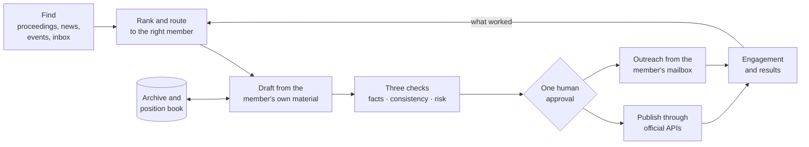

# CredEngine

**Gets a small organization heard. It finds and ranks chances to be seen, quoted or published, then prepares the posts, outreach and press materials for one approval.**

By **Adam Hatefi** · [Owrang Studios](https://owrang.io/studios/) · An optional add-on to [Polletter](https://github.com/thartin/polletter-showcase) for organizations · In active development

> This is a showcase repository. It describes the product and how it is built; the source code is private and is not included here.

---

## What it is

A small nonprofit or association usually has something worth saying and no communications department to say it. The openings are there: a public comment period closing next week, a hearing on its issue, a reporter covering its topic, a news story it could add expert context to. Nobody on staff has time to watch for them all, rank them, and write for each platform.

CredEngine does the watching, ranking and drafting, all in the organization's own voice and from its own material. A person on the team approves everything before it goes out.

## What it does

| | |
|---|---|
| **Find** | Watches for openings: comment periods, hearings and other government proceedings (read straight from Polletter's library of official documents), conferences and calls for speakers, events, news outlets, grant programs, partners' campaigns, and the organization's own inbox. |
| **Rank and route** | Turns each opening into an opportunity, ranks it, and routes it to the right team member. A dashboard and a Monday email show what matters this week. |
| **Write** | Drafts from the member's own material (a voice memo, a document, or a few typed lines) using templates for each kind of piece. |
| **Check** | Runs three checks on every draft: facts, consistency with what the organization has said before, and risk. A draft can be approved only when all three pass, and the database itself enforces that. A flag goes away only when the draft is revised or a person reviews it and signs off. |
| **One message, every platform** | Writes one message, adapts it for each platform, checks that every version still means the same thing, and asks for a single approval. |
| **Publish** | Posts only through each platform's official API, within daily read and write limits. |
| **Engage** | Surfaces the replies and conversations worth answering each day, with a one-line reason for each, drafts responses for approval, and keeps track of the reporters and voices to know. |
| **Outreach** | Sends one-to-one emails from each member's own mailbox and keeps track of the people the organization works with. |
| **Press** | Helps with responding to breaking news, booking broadcast appearances, and releasing reports. |
| **Remember** | Keeps an archive of everything published and a "position book" of what the organization has said on each issue, so past work is reused and stays consistent. Also tracks events, partners, media clips, results and the organization's own newsletter. |

## How it works

## Principles it's built on

- **A person approves everything.** Nothing is posted, sent or replied to without one approval from the right person on the team.
- **Official APIs only.** No scraping. Every platform is read and written through its documented interface, within limits set in configuration.
- **The AI drafts; it doesn't decide.** Models that read outside content have no tools and return structured answers only. A model's later answer can never clear a flag a check has raised.
- **Kept apart from Polletter's newsletters.** CredEngine reads Polletter's government documents, but nothing an organization does in CredEngine ever reaches a Polletter newsletter.
- **Each organization's data is its own.** One organization can never read another's rows, and the keys to connected mailboxes and social accounts are kept where no browser can read them.

## Built with

CredEngine runs on Polletter's infrastructure (sign-in, organizations and roles, billing, background jobs and the document library), with its own tables and pages.

| Layer | Tools |
|---|---|
| Web app | Next.js (App Router, TypeScript) on Netlify |
| Database | Supabase: Postgres with row-level security |
| Background jobs | Trigger.dev |
| AI | Anthropic's Claude API |
| Platforms | Official APIs for Bluesky (AT Protocol), Threads and X; Gmail for outreach |
| Voice memos | Google Cloud Speech-to-Text |
| Media | A Python media service on Google Cloud Run |

## How it's kept trustworthy

CredEngine is built under the same process as Polletter: a written specification, automated guards that are each proven to catch the defect they guard against, an adversarial review of every batch, database changes rehearsed locally and checked read-only against production before they go live, and deploys that are read back to confirm what is running. Every platform connection is tested against that platform's documented responses before it touches a live account.

## Where it stands (November 2026)

In active development as part of Polletter's current phase. The foundation, finders, ranking, writing and checks, messaging, publishing, engagement, outreach, press, events and media are being built and tested together. The interface was recently rebuilt to a new design.

---

### About this repository

This repository contains no source code. The CredEngine name, product and code are proprietary.
Copyright © 2026 Adam Hatefi. All rights reserved.
Questions or a demo: [owrang.io/contact](https://owrang.io/contact/)
